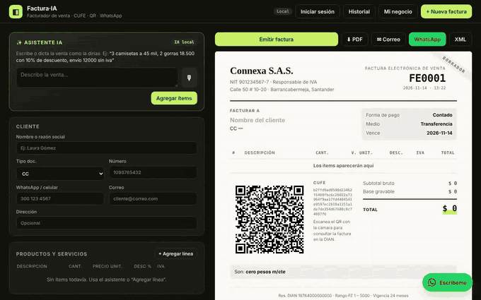

# Factura·IA — Facturador de venta para Colombia

[](https://github.com/Jsonserrano/factura-ia/actions/workflows/deploy.yml)


Aplicación full-stack en **TypeScript** para crear facturas de venta: dictas o escribes la venta en lenguaje natural, la app arma los ítems, calcula los impuestos, genera el **CUFE (SHA-384)**, el **código QR** y el **XML UBL 2.1** con la estructura de la DIAN, y la envía al cliente por **WhatsApp**.

**Demo estática:** https://jsonserrano.github.io/factura-ia/ · **Contacto:** botón *Escríbeme* en la app (solo correos corporativos verificados)



## Funcionalidades

| Área | Qué hace |
| --- | --- |
| **IA** | Convierte frases como *"3 camisetas a 45 mil, 2 gorras 18.500 con 10% de descuento, envío 12000 sin iva"* en ítems. Parser propio en lenguaje natural (entiende "mil", "k", "palos", separadores de miles) + integración opcional con la API de Claude, con respaldo automático si falla. Dictado por voz (Web Speech API, `es-CO`). |
| **Normativa DIAN** | CUFE con la fórmula del Anexo Técnico (verificado contra el ejemplo oficial), QR con los campos exigidos, XML UBL 2.1 perfil DIAN 2.1, dígito de verificación del NIT (módulo 11), IVA 0/5/19 %, retención en la fuente, valor en letras. |
| **Backend** | API REST con Express 5 + SQLite (libSQL local / **Turso** en la nube). Usuarios con contraseñas en **scrypt** y sesiones **JWT**. El servidor asigna el consecutivo dentro de una transacción y recalcula totales y CUFE: el cliente nunca decide los montos. Validación con **Zod**. |
| **PDF y correo** | PDF real generado con `pdf-lib` (mismo código en navegador y servidor). Envío por correo con **PDF + XML adjuntos** vía Brevo, con límite diario por usuario. |
| **WhatsApp** | Mensaje prellenado al cliente con **QR para el celular**, app de escritorio o WhatsApp Web. |
| **Producto** | Facturas emitidas inmutables, historial con KPIs (facturado / por cobrar), marcar pagada o anular, duplicar, diseño responsive. |
| **Contacto anti-spam** | Botón *Escríbeme* que abre WhatsApp directo, pero el número del autor **no está en el código ni en la página**: el servidor lo entrega solo tras una verificación humana invisible (reto firmado con HMAC de un solo uso, prueba de trabajo SHA-256 en el navegador, interacción real, tiempo mínimo y límites por IP y diarios; Cloudflare Turnstile opcional). |
| **Modo sin servidor** | Si no hay backend (por ejemplo en GitHub Pages) la app funciona igual guardando en el navegador: patrón *repository* con dos implementaciones (`repoLocal` / `repoNube`). |

## Arquitectura

```
src/                     Frontend (Vite, sin frameworks) + lógica compartida con el servidor
  calc.ts                Totales, impuestos, número a letras, DV del NIT
  cufe.ts                CUFE SHA-384 (Web Crypto) y contenido del QR
  ubl.ts                 XML UBL 2.1 (DIAN)
  pdf.ts                 Representación gráfica en PDF (pdf-lib)
  plataforma.ts          Integración opcional con el visor de artefactos de Claude
  ai.ts                  Parser de lenguaje natural, Claude API, dictado por voz
  api.ts · repo.ts       Cliente HTTP y repositorio local/nube
  main.ts · style.css    Interfaz
server/
  app.ts                 Rutas Express, validación Zod, manejo de errores
  auth.ts                scrypt + JWT + middleware
  db.ts                  Esquema SQLite (libSQL / Turso)
  contacto.ts            Verificación humana del botón de WhatsApp
  correo.ts              Envío de correos con Brevo
tests/                   Vitest + Supertest (90 pruebas)
.github/workflows/       CI: tipos → pruebas → build → GitHub Pages
```

La misma lógica de negocio (`calc.ts`, `cufe.ts`, `ubl.ts`) corre en el navegador y en el servidor, así que el CUFE que ve el usuario es idéntico al que guarda la API.

## API

| Método | Ruta | Descripción |
| --- | --- | --- |
| `POST` | `/api/auth/registro` | Crea usuario → `{ token, usuario }` |
| `POST` | `/api/auth/login` | Inicia sesión → `{ token, usuario }` |
| `GET` | `/api/me` | Usuario actual 🔒 |
| `GET / PUT` | `/api/emisor` | Datos del negocio 🔒 |
| `GET` | `/api/facturas` | Lista del usuario 🔒 |
| `POST` | `/api/facturas` | Emite: asigna consecutivo, fecha, totales y CUFE 🔒 |
| `GET` | `/api/facturas/resumen` | Facturado, por cobrar, cantidad 🔒 |
| `GET` | `/api/facturas/:numero` | Detalle + totales 🔒 |
| `PATCH` | `/api/facturas/:numero/estado` | `Pagada` o `Anulada` (una sola vez) 🔒 |
| `GET` | `/api/facturas/:numero/xml` | Descarga el XML UBL 2.1 🔒 |
| `GET` | `/api/facturas/:numero/pdf` | Descarga el PDF 🔒 |
| `POST` | `/api/facturas/:numero/enviar` | Envía PDF + XML al correo del cliente 🔒 |
| `GET` | `/api/contacto/reto` | Reto firmado para la verificación humana |
| `POST` | `/api/contacto/whatsapp` | Reto resuelto + interacción real → enlace directo a WhatsApp |
| `POST` | `/api/ia` | Texto → ítems con Claude (llave solo en el servidor, límite por IP) |

🔒 = requiere `Authorization: Bearer <token>`

## Correr en local

Requiere **Node 22.13+**.

```bash
npm install
npm run dev:full     # frontend (5173) + API (3001) a la vez
npm test             # 90 pruebas
npm start            # producción: compila y Express sirve frontend + API en :3001
```

Variables de entorno en [`.env.example`](.env.example). En producción `JWT_SECRET` es obligatorio.

## Despliegue (todo gratis)

| Pieza | Servicio | Para qué |
| --- | --- | --- |
| App completa (frontend + API) | **Render** (plan Free) | `render.yaml` incluido: Render lo configura solo |
| Base de datos | **Turso** (plan Free) | SQLite en la nube: los datos no se pierden cuando Render reinicia |
| Demo estática | **GitHub Pages** | Se publica sola con cada `push` (modo local, sin servidor) |

1. **Turso:** crea la base `factura-ia` y copia su URL (`libsql://…`) y un token.
2. **Brevo:** crea la cuenta, verifica tu correo como remitente y genera una API key.
3. **Render:** *New → Blueprint* → elige este repositorio y completa las variables: `TURSO_DATABASE_URL`, `TURSO_AUTH_TOKEN`, `BREVO_API_KEY`, `BREVO_SENDER_EMAIL` y `CONTACTO_WHATSAPP` (tu número, privado). Opcionales: `ANTHROPIC_API_KEY`, `TURNSTILE_SITE_KEY`, `TURNSTILE_SECRET`. `JWT_SECRET` se genera solo.
4. **GitHub Pages:** *Settings → Pages → Source: GitHub Actions*.

En el plan gratis de Render el servidor se duerme tras 15 minutos sin visitas y tarda cerca de un minuto en despertar.

## Pruebas

- `tests/calc.test.ts`: impuestos por tarifa, descuentos, retención, redondeo, DV de NIT reales, número a letras.
- `tests/ai.test.ts`: parser en lenguaje natural y la integración con Claude (con `fetch` simulado y respaldo local).
- `tests/cufe-ubl.test.ts`: **reproduce el CUFE del ejemplo oficial de la DIAN**, hora de Colombia, QR y validez/totales del XML.
- `tests/pdf-correo.test.ts`: PDF válido y paginado, descarga y envío con adjuntos, límites y permisos.
- `tests/contacto.test.ts`: verificación humana del botón de WhatsApp (firma, prueba de trabajo, un solo uso, vencimiento, bots y límites).
- `tests/api.test.ts`: registro, login, aislamiento entre usuarios, consecutivos, validaciones, estados, XML e IA del servidor con límite de uso.

## Alcance

Genera la representación gráfica y el XML en **ambiente de pruebas**. No firma el XML (XAdES-EPES) ni lo transmite a la DIAN, así que las facturas no tienen validez fiscal. Para producción se necesita certificado de firma digital y habilitación como facturador electrónico, o un proveedor tecnológico.

---

Hecho por **Javier Andrés Reina** · [GitHub](https://github.com/Jsonserrano)
